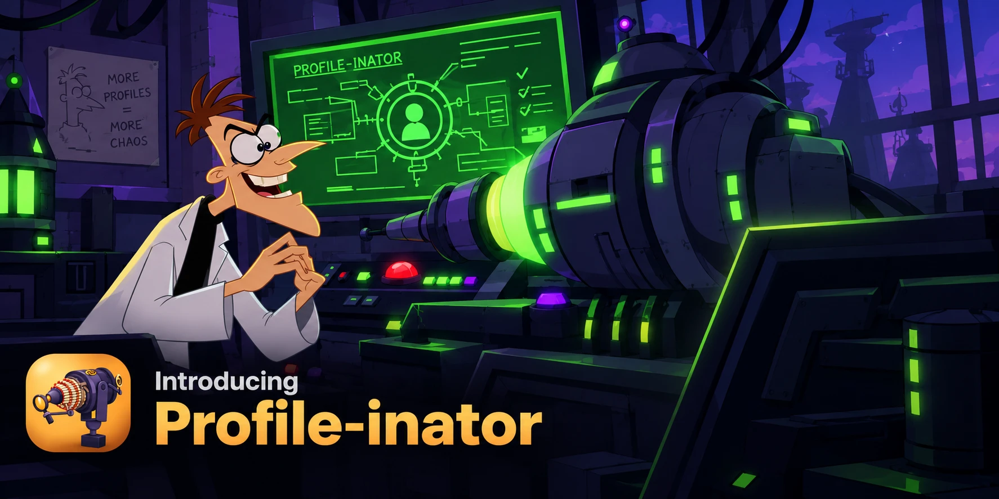
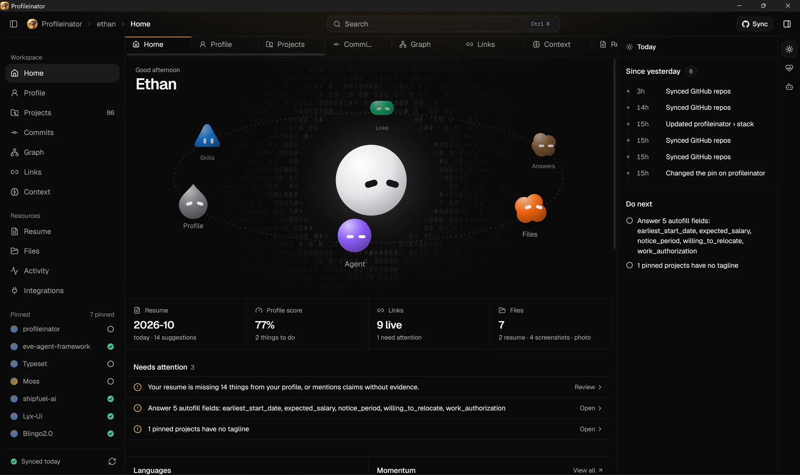
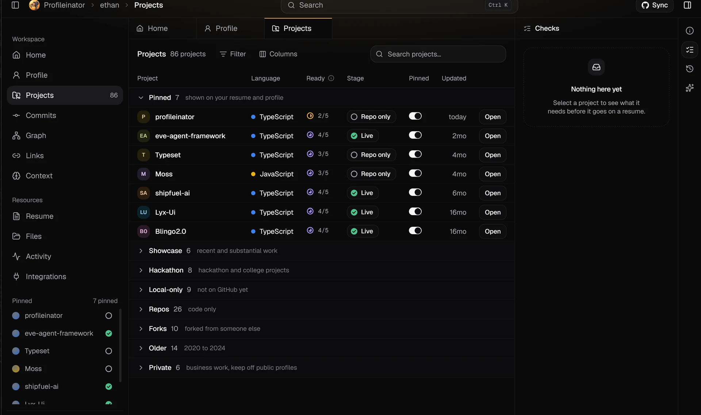
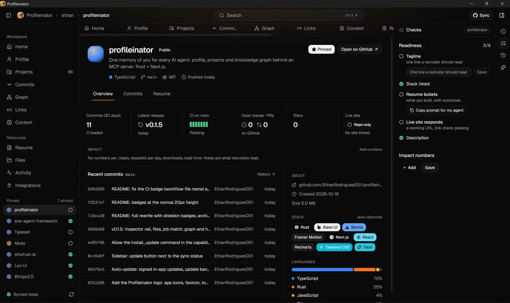
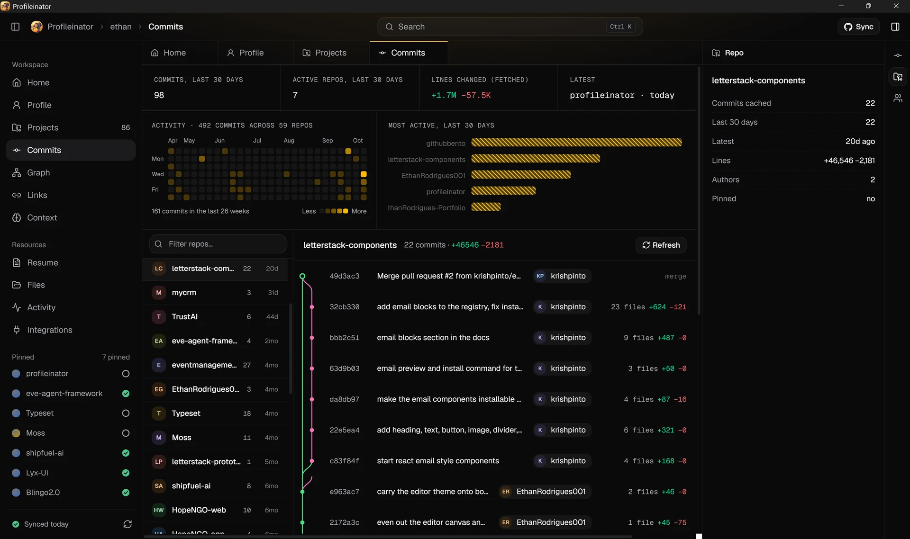
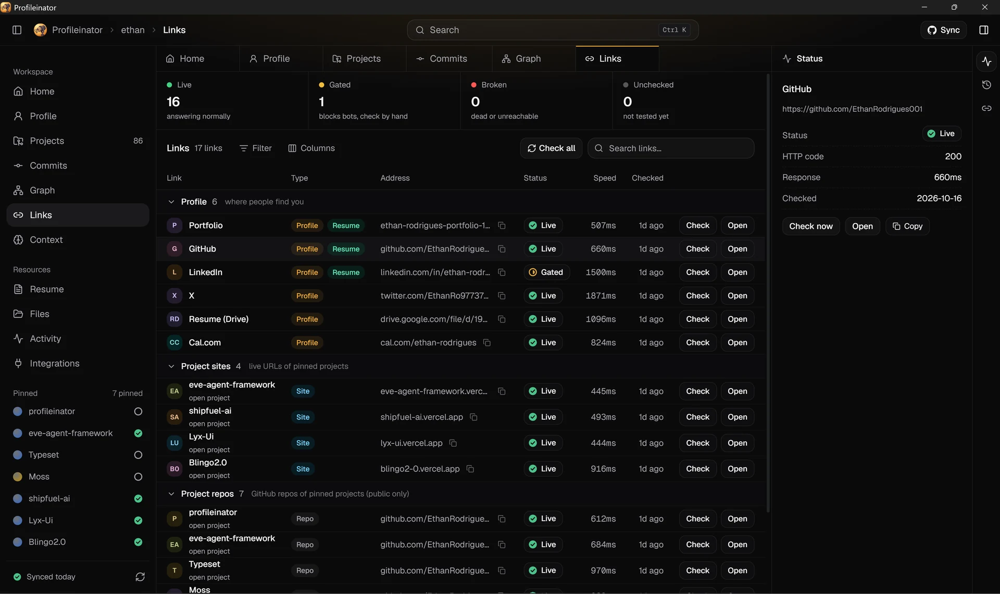
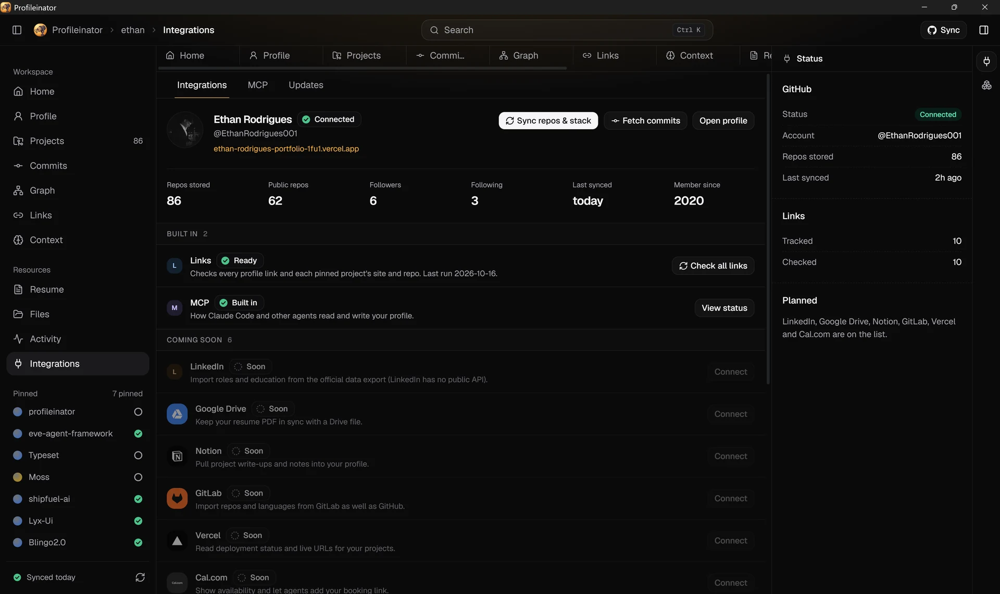
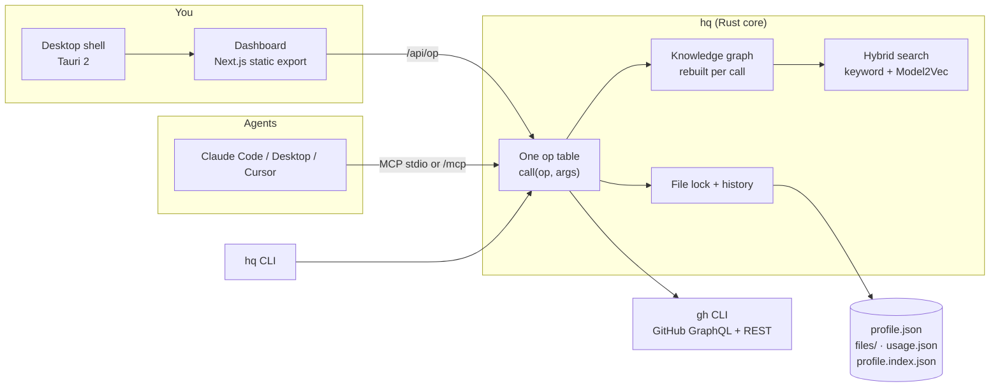

<p align="center">
  
</p>

<p align="center">
  <a href="https://github.com/EthanRodrigues001/profileinator/releases/latest"></a>
  <a href="https://github.com/EthanRodrigues001/profileinator/actions/workflows/ci.yml"></a>
  <a href="https://github.com/EthanRodrigues001/profileinator/commits/main"></a>
  <a href="LICENSE"></a>
  <a href="https://github.com/EthanRodrigues001/profileinator/stargazers"></a>
</p>

<p align="center">
  <b>Profileinator</b> is a local-first app that stores everything about you for your job search: roles, skills, projects, links, files and the answers every application asks for.<br/>
  Your AI agents read and update it over <b>MCP</b>, so they stop asking the same questions and stop making things up.
</p>

<p align="center">
  <a href="#install">Install</a> ·
  <a href="#what-you-get">What you get</a> ·
  <a href="#how-it-works">How it works</a> ·
  <a href="#agent-tools">Agent tools</a> ·
  <a href="#tech-stack">Tech stack</a> ·
  <a href="#releases">Releases</a> ·
  <a href="#contributing">Contributing</a>
</p>

---

<p align="center">
  
</p>

<table>
  <tr>
    <td width="50%"><br/><sub><b>Projects.</b> Every repo plus your own work, grouped, with resume readiness at a glance.</sub></td>
    <td width="50%"><br/><sub><b>Project page.</b> Release, CI, issues, commits, stack and what it needs before it goes on a resume.</sub></td>
  </tr>
  <tr>
    <td width="50%"><br/><sub><b>Commits.</b> Activity grid, most active repos and a branch graph across everything you built.</sub></td>
    <td width="50%"><br/><sub><b>Links.</b> Every profile and project URL with live status, speed and check history.</sub></td>
  </tr>
  <tr>
    <td colspan="2"><br/><sub><b>Integrations.</b> GitHub connection, MCP status and updates in one place.</sub></td>
  </tr>
</table>

## Why

Every AI chat starts from zero. You paste your resume again, retype the same application answers, and the model invents a number or a skill you never claimed. Profileinator is the fix: one place on your computer that knows the real you, that an agent can query with a tool call, and that tells the agent what is **missing** instead of letting it guess.

- **Facts are never invented.** Tools return what is missing; the agent asks you.
- **One file.** Everything lives in a single `profile.json` in your OS config folder. Nothing is in a cloud, nothing is in this repo.
- **Any agent.** Claude Code, Claude Desktop, Cursor or anything that speaks MCP over stdio or HTTP. A CLI and a local HTTP API expose the same operations.
- **Undoable.** Every write is validated and recorded, so any change can be reversed.

## Install

<p>
  <a href="https://github.com/EthanRodrigues001/profileinator/releases/latest"></a>
  <a href="https://github.com/EthanRodrigues001/profileinator/releases/latest"></a>
  <a href="https://github.com/EthanRodrigues001/profileinator/releases/latest"></a>
</p>

**Desktop app (recommended).** Download the installer for your system from [Releases](https://github.com/EthanRodrigues001/profileinator/releases/latest):

| System | Installer | Notes |
| --- | --- | --- |
| Windows x64 | `Profileinator_<version>_x64-setup.exe` or `.msi` | Installs per user, no admin prompt. Custom setup artwork in the app's palette. |
| macOS (Apple silicon) | `Profileinator_<version>_aarch64.dmg` | |
| Linux x64 | `.AppImage`, `.deb` or `.rpm` | |

The desktop app starts the bundled `hq` core, opens the dashboard in a native window and updates itself (signed updates, see [Updates](#updates)).

**One line, no installer.** Downloads the latest release to `~/.profileinator`, installs the Claude Code skill, registers the MCP server and opens the dashboard:

```powershell
# Windows
irm https://raw.githubusercontent.com/EthanRodrigues001/profileinator/main/install.ps1 | iex
```

```bash
# macOS / Linux
curl -fsSL https://raw.githubusercontent.com/EthanRodrigues001/profileinator/main/install.sh | sh
```

**Portable archive.** Each release also ships `profileinator-<os>-<arch>` archives with the `hq` binary, the `ui/` dashboard and `skills/`:

```bash
./hq setup     # installs the Claude Code skill, registers the MCP server, creates your profile
./hq ui        # dashboard at http://127.0.0.1:4777
```

Other MCP clients (Cursor, Claude Desktop, ...): `hq setup` prints the stdio config to paste, or copy [`examples/mcp.json`](examples/mcp.json) and set the real path to `hq`. Clients that take a URL can use `http://127.0.0.1:4777/mcp` while `hq ui` is running (local only).

**Requirements.** None for the core. The [GitHub CLI](https://cli.github.com) (`gh`) is needed only for the GitHub import and commit/release data. The first semantic search downloads a 30 MB model once; set `HQ_SEMANTIC=off` to skip it.

## First run

The dashboard opens on a welcome screen with three steps:

1. **GitHub.** Already signed in with `gh`? One click imports your name, bio, link, every repo, languages and an evidence-based tech stack. Not signed in? **Connect GitHub** starts the browser sign-in and shows the one-time code; the import runs when you approve.
2. **Agent.** **Connect Claude Code** installs the skill and registers the MCP server. For other agents, copy the MCP config or URL.
3. **Prompt.** Copy one prompt into your agent. It interviews you, or imports pasted resume and LinkedIn text, and saves everything with validated, undoable tools. The welcome screen closes on its own when the first data arrives.

## What you get

### The dashboard

A static Next.js app served by the same Rust binary (and wrapped in a native window by the desktop shell). Every page works on the same data an agent sees.

| Page | What it does |
| --- | --- |
| **Home** | A hero where you are the sun and six areas of your profile (Profile, Skills, Links, Answers, Files, Agent) orbit as little characters. Hover one for a status card with real numbers and the next thing worth doing. Below: at-a-glance cards, an attention list, language and momentum charts, pinned projects and the agent log. |
| **Profile** | Identity, banner and photo, experience and education timeline, achievements, tech stack, pinned projects. |
| **Projects** | A dense grouped table of every repo plus anything you add. Readiness checks per project (tagline, stack, bullets, live site, description). Projects that exist only on your computer get a **Local only** stage. |
| **Project page** | Latest release, CI status, open issues and PRs, recent commits, impact numbers, resume bullets, a cover image (upload one or capture the live site) and screenshots. |
| **Commits** | Cross-repo history with a branch graph, a 26-week activity grid and per-repo stats. |
| **Graph** | An evidence explorer over your knowledge graph: pick a skill, project or role and see exactly what proves it. Ask in plain language and walk the connections. |
| **Links** | Every profile and project URL with live status, response time and per-link history. Check one or all. |
| **Context** | The application answers agents autofill (notice period, salary, work authorization, ...), your positioning rules, claim gaps and decisions. |
| **Resume** | The current resume as a PDF with working links, plus **Suggestions** (what the PDF says versus what your profile can back) and **Job match**. |
| **Files** | Resume versions, screenshots and your avatar, stored beside your profile. |
| **Activity** | A timeline of every change and who made it: you, an agent or the terminal, with undo. |
| **Integrations** | GitHub, the MCP server status, built-in tools and updates in one place. |

Search everything with **Ctrl K**: pages, projects, skills, links, files and stored facts.

### The inspector rail

The right-hand rail changes with the page. On Projects it shows readiness checks with a fix next to each; on Links a link's check history; on Context the unanswered questions as inline fields; on Activity the detail of a change with **Undo**. Tabs are the icon strip on its edge. Graph and Resume have no rail.

### Job match

Paste a job description on the Resume page. Profileinator extracts the technologies it asks for and marks each one **backed** (evidence in your profile), **not backed** (do not claim it) or **avoid** (you said you do not want it), with a score and a ready prompt for tailoring. It runs locally and nothing is sent anywhere.

### Files

Resources → **Files** keeps three things on your computer: your profile picture, every resume version you upload (one is marked current) and screenshots you can link to a project, role or achievement. Files live in the `files/` folder next to `profile.json`.

### Agent visibility

Agent reads are recorded in `usage.json` next to your profile (what was read, how often, when), and every write carries its source in the log. You can see which facts your answers rely on and what an agent changed.

### Updates

The app checks GitHub releases and shows a banner. In the desktop app **Update & restart** downloads the signed update and installs it; in the browser and CLI builds it links to the download. Integrations → **Check for updates** checks on demand.

## How it works



- **One op table.** Every capability is one entry in `call()` in `hq/src/main.rs`. The CLI, the MCP server (stdio and HTTP) and the dashboard's `/api/<op>` all go through it, so they can never disagree.
- **One file, one graph.** `profile.json` is the only store. The knowledge graph (people, roles, schools, projects, technologies, claims, decisions and the edges between them) is rebuilt from it on every call, so it cannot drift from the data. Edges are marked `stated` (written in your data) or `derived` (inferred by matching names).
- **Semantic retrieval, locally.** `ask` fuses keyword search (with a small thesaurus) and semantic search, then widens along graph edges. Embeddings are static [Model2Vec](https://github.com/MinishLab/model2vec) vectors (`potion-base-8M`, about 30 MB, downloaded once from Hugging Face and cached). If the model cannot load it falls back to keyword search. Vectors are cached in `profile.index.json`; delete it any time.
- **Traversal.** `graph_neighbors`, `graph_path` and `graph_explain` walk the graph. Projects that are not on GitHub carry a `hosting` fact and sit under the area "Local only (not on GitHub)".
- **Safe writes.** Typed `add_*` tools validate input. Every write is recorded in history, so `undo` reverses it. A lock file makes the app and any number of MCP clients safe to write at the same time.
- **Source tracking.** The calling surface (`app`, `agent` or `cli`) is recorded with every write, and agent reads feed the usage ledger.

## Agent tools

58 tools, the same list over MCP, the CLI and `/api`. The skill in [`skills/profileinator/SKILL.md`](skills/profileinator/SKILL.md) teaches an agent when to use which.

| Group | Tools |
| --- | --- |
| **Read and recall** | `brief` · `onboarding` · `ask` · `get` · `search` · `where` · `export` · `repos` · `links` · `feed` · `log` · `usage` · `storage` · `integrations` |
| **Knowledge graph** | `graph_neighbors` · `graph_path` · `graph_explain` · `graph_stats` |
| **Write (validated, undoable)** | `set_identity` · `add_link` · `add_experience` · `add_education` · `add_achievement` · `add_tech` · `add_skill` · `add_claim_gap` · `add_project` · `update_project` · `set_positioning` · `set_answer` · `note` · `pin` |
| **Autofill and matching** | `autofill` · `match_job` |
| **Files** | `files` · `file_add` · `file_update` · `file_delete` · `set_avatar` · `capture_screenshot` |
| **GitHub (uses `gh`)** | `github_status` · `github_connect` · `sync` · `scan_stack` · `repo_context` · `project_extras` · `commits` · `commits_all` · `commit_detail` |
| **Links** | `check_link` · `check_links` · `link_history` |
| **Recovery** | `undo` · `history` |
| **Updates** | `update_check` |
| **Escape hatch** | `set` · `append` · `del` |

### Interfaces

| Interface | How |
| --- | --- |
| **MCP over stdio** | `hq mcp`, registered by `hq setup` |
| **MCP over HTTP** | `http://127.0.0.1:4777/mcp` while `hq ui` runs, local only |
| **CLI** | `hq <setup\|init\|where\|onboarding\|brief\|get\|set\|append\|del\|note\|log\|search\|repos\|pin\|sync\|check_links\|links\|autofill\|export\|integrations\|ui\|mcp>` |
| **Local HTTP API** | `POST /api/<op>` (needs an `x-hq` header and a local Host), `GET /files/<id>` |

### Your data

Everything is in your OS config folder (`hq where`), or in `$HQ_DATA` if set.

| Path | Contents |
| --- | --- |
| `profile.json` | The profile: `me`, `projects`, `state`, `log`, `history`, `commits`, `files` |
| `files/` | Uploaded resumes, screenshots and avatar, stored as `<id>.<ext>` |
| `usage.json` | The agent read ledger |
| `profile.index.json` | Cached embeddings (safe to delete) |
| `profile.lock` | Write lock shared by the app and MCP clients |

| Variable | Effect |
| --- | --- |
| `HQ_DATA` | Use a different data folder (handy for a throwaway dev profile) |
| `HQ_UI` | Serve the dashboard from a specific folder |
| `HQ_SEMANTIC=off` | Skip the semantic model, keyword search only |
| `HQ_EMBED_MODEL` | Use a different Model2Vec model |

### Privacy

No telemetry, no accounts, no tokens stored. The only network calls are the ones you trigger: `gh` for GitHub, link checks, the update check against GitHub Releases, optional live-site screenshots (only the URL is sent to a public screenshot service) and the one-time model download.

## Tech stack

### Core (`hq/`, Rust)

<p>
  
  
  
</p>

About 3,400 lines in eight modules, with four dependencies and no async runtime.

| Crate | Used for |
| --- | --- |
| [`serde_json`](https://crates.io/crates/serde_json) | The whole data model is `serde_json::Value`, so the profile schema can grow without migrations |
| [`tiny_http`](https://crates.io/crates/tiny_http) | The local server: dashboard static files, `/api/<op>`, `/mcp` and file upload and download |
| [`ureq`](https://crates.io/crates/ureq) | Blocking HTTP client for link checks, update checks and screenshots |
| [`model2vec-rs`](https://crates.io/crates/model2vec-rs) | Local static embeddings for semantic search (optional `semantic` feature, with `fancy-regex` and `hf-hub`) |

Not crates: the **knowledge graph** (`graph.rs`: nodes, typed edges, breadth-first traversal, shortest path, explainable retrieval), the **MCP server** (JSON-RPC over stdio and HTTP), the **file lock, history and undo** (`store.rs`) and the **job matcher** (`match.rs`) are written by hand, in the same binary. GitHub data comes from the `gh` CLI (GraphQL for releases, issues, pull requests and Actions runs), so no token is ever stored.

| Module | Role |
| --- | --- |
| `main.rs` | Op table, CLI, MCP (stdio and HTTP), local server |
| `store.rs` | `profile.json`, lock, history and undo, log, usage ledger, link history |
| `graph.rs` | Knowledge graph, traversal, hybrid retrieval, explanations |
| `fill.rs` | Validated writers, onboarding, repo stack scan, autofill |
| `github.rs` | `gh` integration, sign-in, project extras, screenshots |
| `files.rs` | File store, resume versions, avatar, duplicate detection |
| `match.rs` | Job description matching |
| `embed.rs` | Optional semantic model |

Release profile: `opt-level = "s"`, LTO, one codegen unit, stripped, `panic = "abort"`.

### Dashboard (`ui/`, TypeScript)

<p>
  
  
  
  
  
</p>

A fully static export (`next build`), served by `hq` with no Node server in production.

| Area | Libraries |
| --- | --- |
| Framework | Next.js 16 (App Router, static export), React 19, TypeScript 5 |
| Styling | Tailwind CSS v4 (`@tailwindcss/turbopack`), `tw-animate-css`, `class-variance-authority` |
| Components | shadcn/ui on [Base UI](https://base-ui.com) (`@base-ui/react`) for select, dialog, tooltip and switch; `cmdk` for the search palette; `sonner` for toasts |
| Charts | [Evil Charts](https://evilcharts.com) bar and pie components on Recharts 3, with `motion` for animation; every chart in the app goes through them |
| Visuals | `GradientASCII` from [React Bits](https://reactbits.dev) (WebGL2 ASCII backdrop), hand-drawn SVG characters for the Home orbit, `simple-icons` for technology logos, `lucide-react` icons |
| Documents | `pdfjs-dist` renders the resume with working link overlays; the worker is copied on install |
| Knowledge graph | A custom evidence explorer over `graph_export`, with no layout engine needed |
| Fonts | Geist Sans and Geist Mono |

### Desktop shell (`desktop/`, Tauri 2)

<p>
  
  
</p>

- `tauri` 2 and `tauri-plugin-updater` 2, with updates verified against a minisign public key in `tauri.conf.json`.
- Starts the bundled `hq`, serves the dashboard from it and opens a native window. In development it prefers the sibling `hq` and `ui/out`.
- A custom `install_update` command, allowed for the local origin only through a capability file.
- Installers: NSIS setup and MSI (Windows), dmg (macOS), AppImage, deb and rpm (Linux), with custom Windows setup artwork and a Start Menu folder. The NSIS hooks stop the bundled `hq` before an install or uninstall.

### Build, CI and release

<p>
  
  
  
</p>

- **CI** (`ci.yml`): builds `hq` on Linux, Windows and macOS, runs clippy, and type-checks and builds the dashboard.
- **Release** (`release.yml`, on a `v*` tag): stamps the tag into every manifest (`scripts/set-version.mjs`), builds the portable archives, builds the installers with `tauri-action`, signs the update artifacts and publishes `latest.json`.
- **Installed apps** read `latest.json` from the latest release and offer **Update & restart**.

## Project layout

| Folder | What |
| --- | --- |
| `hq/` | Rust core: CLI, MCP server, local API |
| `ui/` | Next.js and shadcn dashboard (static export) |
| `desktop/` | Tauri shell, installer artwork and NSIS hooks |
| `skills/` | The skill file that teaches an agent the tools |
| `examples/` | MCP client config |
| `scripts/` | Version stamping |
| `.github/workflows/` | CI and release pipelines |

## Releases

Every release ships portable archives plus native installers. Signed update artifacts (`.sig`) and `latest.json` drive in-app updates. See [all releases](https://github.com/EthanRodrigues001/profileinator/releases).

| Version | Highlights |
| --- | --- |
| **v0.1.5** | Per-page inspector rail with agent-readable data; Files store (resume versions, screenshots, avatar); job match, resume suggestions and a PDF viewer with working links; local-only project type shown in the UI, graph and MCP; Home hero with the profile orbit; global search; Integrations, Activity and Links rework; branded Windows installer; 58 tools |
| **v0.1.4** | Fix for in-app update permission ("not allowed by ACL") |
| **v0.1.3** | Signed in-app updates, update banner, MSI and RPM installers, version taken from the tag |
| **v0.1.2** | The Profileinator logo across the app icons, favicon, topbar and welcome screen |
| **v0.1.1** | Native installers: Windows setup, macOS dmg, Linux AppImage and deb |
| **v0.1.0** | First release: Rust core (CLI, MCP, local API), dashboard and portable archives for Windows, macOS and Linux |

<p align="center">
  <a href="https://github.com/EthanRodrigues001/profileinator/releases"></a>
</p>

## Contributing

Issues and pull requests are welcome. Build instructions, the ground rules (one op table, facts are never invented, no personal data in the repo, charts through Evil Charts) and the release and signing process are in [CONTRIBUTING.md](CONTRIBUTING.md).

```bash
cargo build --release --manifest-path hq/Cargo.toml   # CLI, MCP server, local API
cd ui && npm ci && npm run build                      # dashboard -> ui/out
HQ_DATA=/tmp/hq-dev ./hq/target/release/hq ui         # a throwaway profile, http://127.0.0.1:4777
```

<p align="center">
  <a href="https://github.com/EthanRodrigues001/profileinator/graphs/contributors"></a>
</p>

## Plans

LinkedIn import from the official data export (LinkedIn has no public API, so only the export file is used), resume rendering and portfolio push.

## License

[MIT](LICENSE) © Ethan Rodrigues
